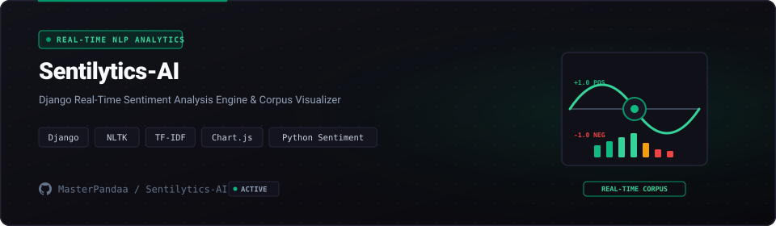

<p align="center">
  
</p>

<p align="center">
  
  
  
  
  <a href="LICENSE"></a>
</p>

## Overview

Customer feedback analysis across online reviews and social media channels requires reproducible NLP model pipelines and clear interpretive dashboards. Sentilytics-AI is an end-to-end text sentiment analytics platform built with **Django 5** and **Scikit-Learn**.

The application combines automated NLP preprocessing, **Random Forest** classification, interactive sentiment distribution gauges, and one-click model pipeline export into serialized `.pkl` formats.

---

## Core Capabilities

- **End-to-End Sentiment Pipeline**: Tokenizes text, cleans slang, generates n-gram TF-IDF matrices, and classifies polarity (Positive, Neutral, Negative).
- **Interactive Django 5 Dashboard**: Real-time visualization of review distributions, prediction confidence scores, and word frequency bars.
- **AutoML Training Console**: Upload arbitrary CSV review datasets, initiate model training with custom hyperparameter splits, and evaluate ROC-AUC curves.
- **Serialized Model Export**: Download trained classification models directly for downstream production deployment.

---

## Quickstart

```bash
git clone https://github.com/MasterPandaa/Sentilytics-AI.git
cd Sentilytics-AI
pip install -r requirements.txt
python manage.py migrate
python manage.py runserver
```

---

## License

This project is licensed under the [MIT License](LICENSE).
